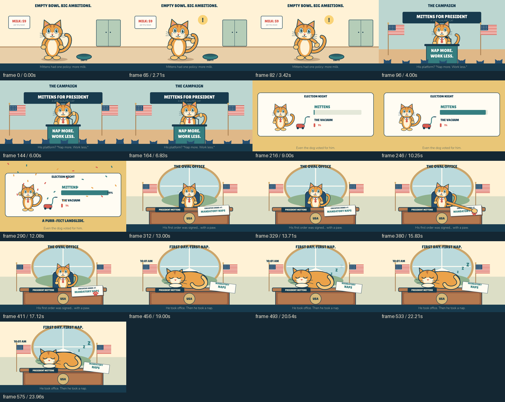

# Mittens takes office

An authored 24-second regression film for the failed cat-president request: a tabby wants more milk, campaigns on naps, defeats a vacuum cleaner, signs an executive order with a paw and sleeps on the presidential desk.

[Watch the MP4](video.mp4) · [Editable scene](scene.json) · [Authoring script](../../../scripts/create_cat_president.py) · [Declared review](review.json) · [Export manifest](manifest.json)

The cat, sleeping pose, kitchen, rally, election board and office are original vector drawings in the authoring script. They are not engine presets. The paw extension is deliberately stylized; there is no physics/contact solver. Sound consists of procedural accents, with no narration.

The implementation model inspected overview and selected contact/action frames. Normal-speed playback, audio listening and independent audience response were not assessed. This demonstrates an authored workflow and identifiable story events, not model parity or guaranteed professional animation quality.
