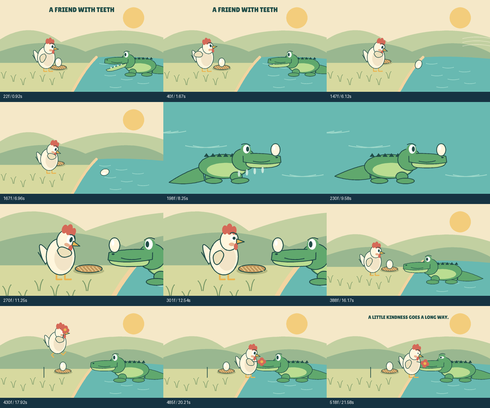

# A Friend with Teeth

A 22-second authored short: a hen fears the crocodile beside her nest; a gust sends her egg toward the river; he catches and returns it; her fear changes to relief and she offers him a flower.

[Read the complete story and shot script](story.md) · [Written plan and self-questions](direction.json) · [Watch the MP4](video.mp4) · [Editable scene](scene.json) · [Authoring script](../../../scripts/create_crocodile_chicken.py)

The plan answers who, what, when, where, why and how, then examines motivation, causality, stakes, clarity, ending and filmability. Six shots establish the relationship, depict danger and rescue, give the hen a closer reaction, return the egg and show reciprocal trust. The runtime contains no crocodile, chicken, rescue or friendship preset.

The author inspected actual preview pixels and temporal strips. Revisions repaired the egg's path across a cut, its deposit into the nest, the nest's final position and flower overlap. The egg follows a snout anchor after contact, and discrete ownership changes use matching transforms. [Contact evidence](review-contact.png), [declared review](review.json), [manifest](manifest.json) and [evaluation record](evaluation.json) document the result.

This remains simple stylized 2D animation. The flower pickup is briefly partly occluded, and cuts compress the crocodile's turn and return travel. Sound contains procedural accents without voices. Normal-speed playback, audio listening and independent audience ratings were not assessed. No second LLM was run to create this example, so it is not evidence that another model will reach the same quality or produce a professional film.
