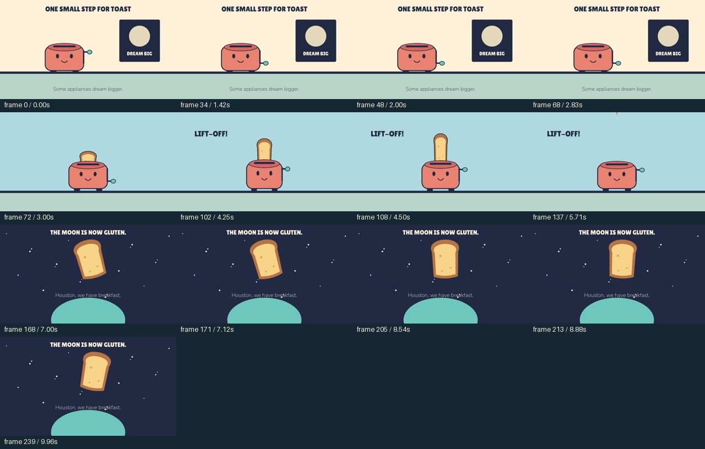

# One small step for toast

A separately authored 10-second film: a toaster sees a space poster, launches its toast, and the toast becomes an absurd moon above a planet. It uses the same unmodified renderer as the cat example, with new geometry, props and motion.

[Watch the MP4](video.mp4) · [Editable scene](scene.json) · [Authoring script](../../../scripts/create_space_toaster.py) · [Declared review](review.json) · [Export manifest](manifest.json)

The implementation model inspected the actual contact sheet and a launch frame showing toast separated from the toaster. Normal-speed motion/audio and independent model transfer remain unassessed. The exposed script is an illustration of authoring, not a template to impose on another brief.

This is a historical v0.2 production and review. Its artifacts remain unchanged. A new v0.3 production needs a written direction plan and a fresh quality review; see the [story-development guide](../../../agent-kit/code-animation/references/story-development.md).
