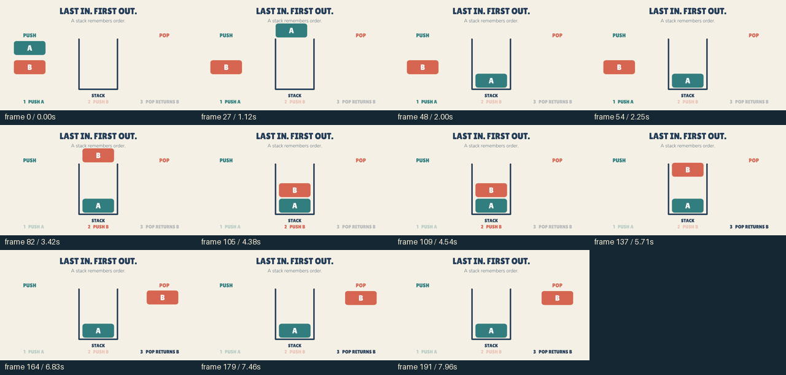

# Last in. First out.

An 8-second educational script with no character narrative: A enters a stack, B enters above it, then B exits first while A stays. Geometry, labels and keyframes use the same engine as the character stories. The entry/exit paths were revised after frame inspection to pass through the top of the stack.

[Watch the MP4](video.mp4) · [Editable scene](scene.json) · [Authoring script](../../../scripts/create_stack_explainer.py) · [Declared review](review.json) · [Export manifest](manifest.json)

The implementation model inspected the sequence and revised transition samples. Normal-speed playback/audio and independent model transfer remain unassessed. This is an authored demonstration, not a held-out model benchmark.
