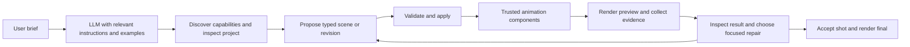

# An animation capability kit for other LLMs

Product clarification: 13 October 2026. Status: original design below; a first working native 2D kit is now implemented. See [the repository](../README.md) and [implementation scope](../docs/IMPLEMENTATION.md). Proposed 3D actions and completed model-comparison results remain outstanding.

## Goal and scope

The main product is a reusable system that helps other LLMs produce good code-driven animation by supplying animation knowledge, tested components, narrow tools, worked examples and a render–inspect–repair workflow. Blender and FFmpeg are execution components underneath this system. A standalone studio interface is secondary.

The intended transfer is explicit, reusable engineering and artistic knowledge: how to break a brief into shots, choose readable poses, time an action, maintain contact, frame a reaction, diagnose a poor result, and make a focused correction. We can encode methods and examples; we cannot promise that instructions alone reproduce every capability or judgment of a stronger model. The target is comparable output on a defined supported set of animation tasks, measured against an actual baseline.

**Hard requirement: zero video-generation models.** All frames come from editable assets, code-controlled animation, rendering and conventional compositing. A text LLM may plan and direct. A vision-capable model may inspect rendered frames if available; it does not generate or replace them. A text-only model receives measured diagnostics and needs a human or separate permitted visual reviewer for aesthetic judgments it cannot observe.

## What we package

| Layer | Concrete contents | Responsibility removed from the consuming LLM |
|---|---|---|
| Operating instructions | A short entry guide, capability discovery, production stages, revision rules, completion evidence and stopping conditions | Remembering the whole workflow or guessing when a shot is finished |
| Animation knowledge | Small task-specific recipes for staging, anticipation, holds, gaze, reaction timing, facial expression, contacts, camera grammar and sound | Reconstructing animation practice from a vague prompt |
| Worked examples | Actual successful projects, inputs, source assets, before/after previews, tool-call records and concise decision notes | Inventing scene structure and implementation conventions from scratch |
| Reusable components | Compatible rigs, action variants, interpolation/IK/contact controllers, cameras, lighting looks, material presets and compositing effects | Writing and debugging low-level animation code for each video |
| Tool interface | Discover capabilities, inspect project/state, propose and validate edits, apply revisions, preview, inspect artifacts and render final | Managing raw Blender commands, file locations and execution details |
| Feedback and repair | Located errors, measurements, temporal evidence, issue-specific repair recipes and bounded iteration | Guessing what failed or regenerating an entire project for a local defect |
| Durable project memory | Approved brief/style, asset locks, decisions, revision history, unresolved issues and accepted shots | Depending on an ever-growing chat transcript |
| Evaluation harness | Held-out briefs, identical revisions, fixed budgets, independent review and recorded interventions | Assuming a convincing demo proves that the kit transfers capability |

The instructions used to **build** these components are different from the instructions an LLM uses to **make a video** with them. The existing `CODING-AGENT-TEMPLATE.md` is a developer handoff. It is not the user-facing animation skill pack and does not, by itself, satisfy this product goal.

## Runtime workflow

1. Load the short entry guide and a capability catalog that reflects what is actually installed. Establish the intended result and explicit missing requirements.
2. Retrieve the relevant recipe, one or two compatible examples, exact tool schemas and the current project summary. Use simple indexed lookup first; a vector database is unnecessary for a small curated library.
3. Turn the brief into shot purposes, actions, timing, framing and acceptance criteria. Bind every requested asset/action to a real capability or return a missing-capability record.
4. Propose structured documents or named-ID revisions. Validate before mutation; the existing project transactions preserve undo and prevent partial edits.
5. Render a cheap preview. Inspect a playable clip or a sequence of sampled frames, plus action-boundary frames and state/contact traces. A single screenshot cannot establish motion quality or continuity.
6. Classify the defect: unsupported capability, wrong plan, timing, staging, asset limitation, solver failure or renderer problem. Choose the matching repair recipe and change the smallest relevant input. Compare against the requested effect and unchanged requirements.
7. Stop at the explicit iteration/tool/token/render budget. Preserve the best valid version and report unresolved issues. Final success requires both technical evidence and the applicable visual review; a successful tool call alone is insufficient.

## Knowledge and tool contracts

Each recipe should state: identifier/version, purpose, supported rig/action/style profiles, prerequisites, required context, decision rules, parameter ranges, a worked example, observable failure signs, repair choices and stopping criteria. Guidance such as "make the acting better" is insufficient; a reaction recipe should connect the requested emotion to gaze, pose, hold duration and camera choices, then explain what to inspect. Values must be tested against the actual assets rather than invented as universally valid defaults.

Each example should include the brief, capability versions, source project, tool inputs/results, rendered evidence, rejected attempt where useful, focused revision, final limitations and rights. Concise observable decision notes are enough. Synthetic contract fixtures remain schema examples and must never be labeled successful visual examples.

The following are **proposed tool roles**, not existing endpoints:

| Tool role | Result and boundary |
|---|---|
| `discover_capabilities` | Installed action/rig/style/tool IDs, versions, limitations and compatible combinations |
| `get_context` | Bounded relevant recipes, examples, exact tool schemas and current project facts; reports missing material |
| `inspect_project` | Read-only scene, shot, asset and world-state summaries with project revision |
| `validate_proposal` | Located schema/semantic issues and permitted repair hints; never invents missing actions |
| `apply_revision` | Existing atomic revision service with expected revision and invalidation list |
| `preview` | Bounded render job using the same compiler/renderer as final, at a preview profile |
| `inspect_artifact` | Artifact paths/IDs, frame/time locations, dimensions and measured diagnostics; images/clip exposed when the host supports them |
| `render_final` | Existing render/assembly services on a reviewed project revision; completion manifest and editable source references |

Tool schemas should remain identical across a local CLI/JSON transport, optional MCP wrapper and provider-specific tool adapters. Start with one transport. A tool wrapper exposes existing application services; it does not create a second scheduler or animation implementation. Provider support for tool calling or images is discovered and recorded. Parsing, retries and output limits must be explicit.

The LLM chooses intent and parameters. Tested code owns geometry, rig constraints, contact, scene evaluation and rendering. Unsupported new behavior becomes a separate component-authoring task: implement, test, review and register it before it is exposed to animation agents. This lets the library expand while keeping the production loop dependable.

## First capability-transfer experiment

Use a small original 5–10-second task with a real approved character: turn attention to an object, show a readable reaction, and change the timing and camera on request. This early slice is an experiment proposal; it is not covered by the existing synthetic courtyard fixture checks. Limit it to the action/camera tools actually implemented. Preserve the 20-second two-character courtyard scene as the later interaction and continuity test.

Run the same held-out briefs and revisions through these conditions:

1. A stronger reference model using the full kit.
2. The chosen smaller/other model using the full kit.
3. That same other model using the same engine/assets and basic tool documentation, without the curated recipes/examples/repair guidance.

An instructions-only condition can help diagnose which layer adds value, but it must not replace the full-kit test. Keep assets, tool versions, target format and comparison budget explicit. Report tool access differences. Record all prompts, tool calls, repairs, failures, render time, model usage and manual intervention. Exclude the exact worked examples from the held-out set; vary action timing, object placement, camera and requested emotion within supported capabilities.

Score brief fulfillment, visual appeal, acting clarity, contact/continuity, revision locality, completion rate, human rescue and cost per accepted result. Use independent blind review where possible. A model should not certify its own aesthetic parity. Report observed score differences and variation; if proposing an equivalence margin, define it before examining results. No parity claim is justified until the benchmark is actually run. No video-generation model is needed for this experiment.

The first meaningful product proof is: a fresh session of another LLM receives the installable kit and a new supported brief, produces and revises a video through the provided tools, and reaches the chosen quality threshold with disclosed assistance. A manually authored Blender demo proves the engine path but does not prove knowledge transfer.

## Revised implementation order

Keep the existing T00–T15 engine and application tasks, but add an early capability-kit lane. Task identifiers below are proposed work and all are **not_started**.

| Task | Dependencies and owned deliverable | Acceptance |
|---|---|---|
| K00 — Entry guide and capability contract | Begin alongside T00/T01. Own `knowledge/entry.md`, recipe format, capability catalog format, supported-task list and held-out evaluation specification | Clearly separates available from proposed tools/assets; a task packet fits a declared context budget; evaluation cannot be solved by copying its example |
| K01 — Initial recipes and verified examples | Draft alongside T00/T01; rendered examples require working real assets and relevant action tools. Own `knowledge/recipes/`, `knowledge/repairs/`, `examples/golden/` | Each claimed successful example rebuilds and has reviewed visual evidence; examples declare limitations; no synthetic fixture is presented as animation |
| K02 — Tool/context and bounded agent loop | Contract work starts after K00 and T01/T03; live preview requires relevant worker/action/compiler services. Own `studio/context/`, `studio/agent_tools/`, workflow state and transport adapter | Tools wrap shared services; relevant context is bounded; errors map to repairs; limits stop retries; text-only and visual-host support are reported accurately |
| K03 — Transfer benchmark | Begin rubric and harness early. Actual experiment needs K01/K02, T12 and a functioning native render slice; full interaction qualification follows T11 | Compare stronger/full, other/full and other/basic conditions on held-out tasks; preserve all attempts and assistance; report actual differences, not assumed parity |
| K04 — Consumable kit release | K03 evidence and T13 installation checks. Own entry documentation, pinned recipe/tool/asset manifests and host setup guides | A fresh supported agent session discovers tools, produces a new supported scene, revises it and exports editable source/video without undocumented expert intervention |

T12's provider-independent planning and bounded repair loop are central product work, not a late optional feature. Their interface and data-only evaluation begin early; live tests start when real tools exist. Full release qualification still needs native rendering and visual gates. K02 must not fake missing services to claim an end-to-end success. If the initial slice cannot yet animate and render, record the engine dependency and continue the knowledge/evaluation work independently.

Do not build a large frontend before the transfer experiment establishes value. Expand the library based on observed recurring failures: add a reusable action, improve a recipe, supply a missing diagnostic or simplify a tool. Model training and fine-tuning are outside the initial plan; they should not hide whether instructions, tools and components actually help.

## Evidence limits

This revision establishes the correct product objective and a way to test it. The current package contains research, proposed contracts and synthetic fixtures. The previous 45 checks validate those fixtures only. There is no working capability kit, verified visual example library, installed runtime, completed render or measured model-parity result yet.
