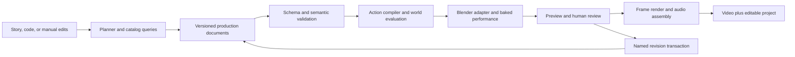

# An LLM animation capability kit with a code-to-video runtime

Research checked 12 October 2026 • Report completed 13 October 2026 • Design version 0.1.0

**Implementation update:** a first working native 2D kit now exists in [the repository](../README.md). Its implemented scope, separate 2D contract and remaining 3D work are recorded in [release decisions](../docs/IMPLEMENTATION.md). The proposed Blender architecture below is not a claim that those components have shipped.

**Product goal clarified:** package animation expertise as reusable instructions, task-specific knowledge, verified examples, tools, components and a preview–inspect–repair workflow so other LLMs can produce better code-driven animation. The scene compiler and studio below are execution infrastructure for that kit. Read [the capability-kit design](LLM-ANIMATION-KIT.md) first; it defines the primary product, early knowledge/tool work and the experiment needed to measure capability transfer. Comparable quality on supported tasks is a target, not an established result.

**Recommendation:** build a code-to-video studio around Blender, a curated library of character performances, and a versioned production document. Every output frame comes from explicit scene assets, animation, rendering, and conventional compositing. **Video-generation models are excluded from the product, including optional enhancement, video-to-video refinement, and generative frame interpolation.** Text LLMs may help direct structured scenes; they do not synthesize video pixels. The proposed advantage is dependable direction, continuity, revision, and reuse within a deliberately chosen visual style. This report does not establish that a prototype already beats existing products.

This is the research and implementation handoff stage. No animation application, character assets, production renderer, or generated comparison videos have been built. The accompanying JSON examples specify interfaces; their validation status is recorded separately. Public documentation and selected source files were inspected; no hosted generation was purchased and no model or animation engine was benchmarked.

Read this report after [the product-level capability-kit design](LLM-ANIMATION-KIT.md). Supporting material lives in [contracts](contracts/CONTRACTS.md), [core component evidence](evidence/core-components.md), and [video-model and REA evidence](evidence/video-models-and-rea.md). Those files preserve additional sources and investigation details. The decisions and task order below, together with K00–K04, are the proposed implementation baseline.

## A. Vision, success criteria, assumptions, and non-goals

The user wants a system that lets other LLMs use packaged expertise, instructions, tools and components to produce attractive, coherent code-driven animation. Success includes the consuming LLM's ability to plan, preview, diagnose and revise a new supported scene, with measured quality and disclosed expert assistance. Human-made online animation informs aesthetic targets. Natural language is an authoring interface; a direct structured-text interface also remains available for debugging and expert control. The goal covers varied stories; a boat journey is only one possible scene.

A finished project contains editable assets, actions, dialogue, scene state, shots, and render manifests alongside its MP4. A successful system can reuse the same cast next episode and change one performance without reconstructing the production.

Initial success means: a polished 20-second sequence with two recurring characters, three shots, one intentional emotional beat, dialogue, and an object exchange; reliable camera, expression, and timing revisions; zero use of video-generation models; a documented cost and correction-time record. Final pixel quality remains a test outcome, not a promise.

That sequence is the native-engine qualification milestone. The central product milestone is capability transfer: a fresh session of another LLM uses the kit to create and revise a held-out supported scene. Begin with a smaller 5–10-second single-character slice when real tools are ready, then extend to the 20-second interaction. Instructions for coding agents to implement the system are useful development material, but are not the production-time knowledge/tool kit the user is asking for.

Assumptions: Windows is the first supported host because the current workspace is on Windows. RAM, GPU, spending ceiling, artistic skill, and target episode duration are unknown. Development therefore starts with a small scene and selectable low-resolution previews. A 24 fps project, 48 kHz audio, and 1080p delivery are design defaults, not performance claims. The first demonstration is 20 seconds; a practical later MVP targets 30–90 seconds assembled from short shots. Longer episodes use the same project model but require separate endurance and editorial tests.

The first release supports one compatible humanoid rig profile, a small curated cast, one art direction, simple indoor/outdoor sets, and a bounded action vocabulary. It does not automatically rig arbitrary meshes, invent every requested action, simulate every physical phenomenon, or train a foundation video model. Human art direction, asset preparation, pose cleanup, and approval of the final result remain part of production.

“Better” has four independent meanings: visual appeal, instruction fulfillment, edit reliability, and total production effort. We will report all four. It is possible to improve edit reliability while still losing on visual appeal. Structural consistency alone is insufficient.

## B. Research coverage, findings, comparisons, and gaps

Evidence labels throughout: **D** = official documentation or authors' paper; **C** = selected source inspected; **T** = executed locally; **P** = proposed design or engineering inference. A repository being public, recently updated, or popular is not evidence of output quality. Unless explicitly stated otherwise, no runtime testing was performed.

| Production area | First implementation | Later / optional work | Evidence and remaining gap |
|---|---|---|---|
| Story, bibles, directing | Human-reviewed story beats, character/world bible, shot purposes and thumbnails | Longer narrative planning, richer camera grammar | Code2Video provides a planning/critique precedent; it targets education, not sustained character acting |
| Character art and identity | Two prepared characters, locked assets/materials, expression and mouth controls | Custom creation, automatic rigging, wardrobe variants | Blender production accounts demonstrate the importance of coordinated art and rigs; our assets do not yet exist |
| Motion and interaction | Authored clips, explicit contact events, limited IK correction | Retargeting, motion matching, motion generation | Blender supplies mechanisms; a validated performance library must be authored |
| Sets, light, camera | Modular set, approved material/light presets, camera templates | Terrain generation, larger scene layout | Production look development is still an artistic dependency |
| Simulation | Kinematic character/prop motion and collision proxies | Baked rigid bodies, cloth, hair, water, particles | Simulation is useful selectively; universal simulation is not an MVP dependency |
| Assets and rights | Local catalog, hashes, provenance, import normalization | Online search adapters, asset conversion services | Availability is not compatibility or redistribution permission |
| LLM direction | Provider adapter, bounded plans, schema + semantic validation | Local models, visual critique, selective stronger-model escalation | Grammar constraints improve syntax; they cannot certify meaningful animation |
| Timeline, rendering, finishing | Shared scene time, shot intervals, Blender renders, FFmpeg assembly | OTIO interchange, sophisticated compositing, HDR | Renderer interoperability and color management need a fixture test |
| Sound and dialogue | Imported/recorded speech, timed mouth cues, SFX, music, captions | Replaceable TTS and stronger facial speech models | Timing and performance need human review; voice/model rights remain separate |
| Editing and durability | Named-ID transactions, snapshots, undo, action overrides | Blender panel, browser dashboard | Round-tripping arbitrary Blender edits is intentionally limited |
| Operations | One local worker, durable jobs, cache, cancellation, resumability | Multi-GPU workers and remote execution | Hardware throughput has not been measured |
| Additional essentials | Color management, readability, accessibility, dependency locking, regression renders | Localization, collaborative editing | These affect deliverability even though they are less visible than generation |

**The closest existing approaches teach useful lessons.** [Code2Video](https://github.com/showlab/Code2Video) separates planning, Manim generation, and visual critique. Its [agent source](https://github.com/showlab/Code2Video/blob/1142d8e14cdc2806df85aedb0fbb5dca474caa0f/src/agent.py) includes per-section code, render/debug loops, retries, and token tracking. Adopt bounded decomposition and cost logging; do not equate its educational-video results with character-story production. Its reliance on generated executable code also leaves a larger repair surface than a fixed action language. **D/C/P**

[SceneCraft](https://arxiv.org/abs/2403.01248) explores text-to-Blender scene construction. [VideoCoCo](https://arxiv.org/abs/2607.27380) describes executable Blender drafts followed by generative video editing. [I2V3D](https://bestzzhang.github.io/I2V3D/) uses 3D guidance and generative refinement. These are related research approaches. The latter two use frame-synthesis stages excluded from this product; their existence does not justify adding those stages to our architecture. Their published results are authors' evaluations; this investigation did not reproduce them. **D/P**

The community [MCP for Blender](https://github.com/ahujasid/mcp-for-blender) exposes direct Blender control. Its [execute_code implementation](https://github.com/ahujasid/mcp-for-blender/blob/7a0373ec9199183cb460068c4f96aed9c579fb4f/addon.py) executes supplied Python. It is useful for interactive investigation, but a general tool bridge is not our production document, action scheduler, or continuity system. The runtime proposed here only dispatches reviewed implementations of allowed actions. **C/P**

### Component decisions

Integration effort is relative engineering judgment: low = a narrow file/process adapter; medium = several conversion or validation rules; high = substantial animation/model integration. Maintenance entries are observations, not support guarantees. Detailed version/license evidence is in the linked memos.

| Component / source | Capability and license | Evidence / maintenance observation | Compute; integration | Limitation and decision |
|---|---|---|---|---|
| [Blender](https://www.blender.org/) | Scene authoring, animation, render; GPL, output rights separate | D/C; official LTS releases; exact tested build must be locked | CPU/GPU by engine; medium | Art and rig work remain. **Adopt** as sole initial animation backend |
| [Rigify](https://docs.blender.org/manual/en/latest/addons/rigging/rigify/introduction.html) | Rig generation; Blender GPL context | D; distributed with supported Blender tooling, pin matching version | Local CPU; medium | Generated control names are not a portable public API. **Adapt** behind one frozen rig profile |
| [FFmpeg](https://ffmpeg.org/legal.html) | Audio/video finishing; LGPL/GPL varies with build | D; releases available, record build configuration | CPU/GPU codec-dependent; low | Codec/build redistribution conditions differ. **Adopt** external executable |
| [jsonschema](https://python-jsonschema.readthedocs.io/en/stable/validate/) | Draft 2020-12 validation; MIT | D; documented validator API | CPU; low | Does not enforce scene semantics. **Adopt** with explicit semantic checks |
| [Remotion](https://www.remotion.dev/docs/) | React video compositions; custom license | D/C; source and render APIs inspected | Browser/Node; medium | Eligibility and derivative restrictions; no ready character pipeline. **Defer** to optional graphics |
| [Motion Canvas](https://motioncanvas.io/docs/) | Scripted vector animation; MIT | D/C; starter inspected; stable-release age merits a packaging check | Browser/Node; medium | Character interaction machinery would be ours. **Defer** |
| [Manim](https://docs.manim.community/en/stable/) | Mathematical/educational animation; MIT | D/C; examples and CLI inspected | CPU/OpenGL by renderer; low for isolated inserts | Abstraction is specialized. **Defer** to educational inserts |
| [Code2Video](https://github.com/showlab/Code2Video) | Agentic Manim generation; MIT code, separate asset rights | D/C; main commit dated 24 Aug 2026 | LLM/VLM calls + local render; high as a fork | Education-specific. **Adapt ideas**, independently implement core |
| [MCP for Blender](https://github.com/ahujasid/mcp-for-blender) | LLM-to-Blender tools; repository MIT declaration | D/C; main commit dated 6 Oct 2026 | Blender + bridge; low exploration, high hardening | Arbitrary Python surface; bundled components require review. **Optional research tool** |
| [llama.cpp](https://github.com/ggml-org/llama.cpp) | Local inference; MIT runtime, separate model licenses | D; main moving on research date | Model/quantization-dependent RAM/VRAM; medium | JSON Schema subset and model reasoning limits. **Optional provider adapter** |
| [Rhubarb Lip Sync](https://github.com/DanielSWolf/rhubarb-lip-sync) | Audio-to-mouth cues; MIT | D; older release, isolate/pin CLI | CPU; low | Coarse mouth poses, not full emotional facial acting. **Adopt optional adapter**, imported cues first |
| [Poly Haven](https://polyhaven.com/license) | Environments, materials, HDRIs; CC0 assets | D; API terms separately versioned | Disk/texture memory; low manual import | Mostly not a ready stylized cast. **Adopt selected assets**, restyle |
| [glTF](https://registry.khronos.org/glTF/specs/2.0/glTF-2.0.html) | Asset interchange specification; individual assets have their own licenses | D; standard/specification | Conversion memory; medium | Complex authoring rigs/constraints need baking. **Adopt import/export boundary**, not master scene format |
| [OpenTimelineIO](https://github.com/AcademySoftwareFoundation/OpenTimelineIO) | Editorial timeline interchange; Apache-2.0 | D; main commit dated 9 Oct 2026 | CPU; medium | Editorial clips are not character actions. **Defer** exporter until core works |
| [REA](https://github.com/morluto/rea) | Evidence-based software investigation; MIT-authored code + third-party terms | D/C; source inspection in evidence memo | Depends on analysis provider; medium | Does not supply animation assets or acting. **Optional research**, no runtime dependency |

This is intentionally a small production core: Python, jsonschema, Blender, and FFmpeg. SQLite is only a rebuildable local job/cache index. No vector database, distributed agent framework, cloud control plane, or separate game renderer is required for the first release.

### Video models and online-video comparison

Video models are external comparison targets only. Their adapters, checkpoints, generation endpoints, and refinement stages are outside the application and its roadmap. Comparisons can begin with documented capabilities and existing published outputs; running new model baselines would be a separate research exercise, never a prerequisite for shipping the studio.

| Alternative | Verified direction of capability | Proposed evaluation, not a claimed ranking |
|---|---|---|
| [Google video APIs](https://ai.google.dev/gemini-api/docs/video) | Conversational edits and guided generation; precise supported inputs depend on the model endpoint | Test original brief and local revisions, including preservation of unrelated content |
| [Runway](https://docs.dev.runwayml.com/guides/models/) | Generation and editing model families | Compare accepted outputs, action fulfillment, retakes, and total operator effort |
| [Wan2.2](https://github.com/Wan-Video/Wan2.2) | Released local text/image-to-video models; Apache-2.0 release | Local baseline if hardware fits; this is a specific release, not a claim it is the newest Wan |
| [LTX](https://github.com/Lightricks/LTX-2) | Audio/video generation and conditioning pipelines; custom model license | External comparison only, with exact model version and memory settings logged if measured |
| Our proposed scene compiler | Persistent state, explicit actions, reusable cast, deterministic build inputs | Must prove visual appeal and savings after asset preparation and cleanup are counted |
| Human-made online animation | Finished artistic production | Reference for style and acting; production cost cannot be inferred from the finished upload |

Some current provider landing-page summaries and detailed endpoint restrictions differ. The evidence memo records these limitations. Any separately measured comparison must verify the exact endpoint's capabilities; never assume family-level marketing describes every endpoint. No such endpoint is integrated into the studio.

No reference clips were supplied by the user. [Wing It!'s production breakdown](https://studio.blender.org/blog/shading-and-rendering-of-wing-it/) is a useful reference for 3D with 2D appeal; [Sprite Fright's animation style guide](https://studio.blender.org/blog/sprite-fright-style-guide/) shows deliberate pose, timing, and expression decisions. These were researched as production accounts, not subjected to a shot-by-shot visual score in this work. High-quality renders from Blender demonstrate a possible artistic ceiling, not what our automation will achieve.

Important gaps: no prepared cast, no verified hardware throughput, no action corpus, no demonstrated small-model success rate, no matched video comparisons, and no rights-cleared production asset pack. These are experiments and production tasks in sections G–J, not hidden implementation details.

## C. Feasibility and recommended stack

**Choose stylized 3D with a restrained camera language and optional 2D overlays.** Start with three-quarter and side views, readable silhouettes, approved toon materials, and a small set of focal lengths. This gives editable depth, occlusion, prop contact, and camera changes while pursuing cartoon aesthetics. Anime appeal also needs suitable facial designs, poses, deformation, and timing; a toon shader alone cannot provide it. **P**

| Visual approach | Benefit | Cost / limitation | Decision |
|---|---|---|---|
| Illustrated 2D puppets | Strong designed artwork; efficient limited animation | New viewpoints and foreshortening need artwork/rig variants | Keep as a future renderer adapter; revisit if reference clips favor limited animation |
| 2.5D cards and layered art | Quick environments, parallax, economical staging | Camera movement exposes flatness; difficult contact geometry | Use for backgrounds where the shot permits |
| Stylized 3D | Shared spatial world, pose control, reusable camera angles | Modeling/rigging/acting effort up front | **Default** |
| Photorealistic 3D | Precise physical structure and lighting | Asset complexity and render/animation expectations are much higher | Defer |
| Video-model-only | Broad appearance generation without building every asset | Source project lacks our explicit rig and state model; revisions need measurement | External comparison only; excluded from product |
| Scene-guided video enhancement | Potentially richer appearance from controlled motion | Extra compute, temporal drift, contact/identity changes, divergent final pixels | Related research only; excluded from product |

Python 3.11 is the proposed external orchestration baseline; use an isolated virtual environment and select dependency versions during the installation spike. Blender runs its own bundled Python in a separate process. Exchange JSON files, not Python objects or imported Blender modules across interpreters. Pin the exact Blender LTS patch and adapter together. Prefer EEVEE for the initial styled scene where supported; maintain a Cycles profile for hardware compatibility/quality experiments, with separate look validation. Do not promise an identical look when switching engines.

Use Blender itself for pose/camera editing initially. A small command interface handles validation, build, render, revise, and status. The MVP adds a Blender sidebar with the shot list, action parameters, preview, and errors. A browser dashboard is later convenience; implementing two independent viewports or timelines immediately would create synchronization work without resolving the visual-quality risk.

Expected advantage: once good assets/actions exist, repeated episodes can reuse them and edits can address explicit state. Expected disadvantage: a new creature, costume, set, or unfamiliar action may require manual production work. The break-even point depends on reuse and will be measured rather than assumed.

## D. System architecture and runtime

The capability kit wraps these services with curated recipes/examples, bounded context retrieval, model-facing tools and a workflow that inspects rendered evidence before choosing a repair. See [kit interfaces and responsibilities](LLM-ANIMATION-KIT.md). The runtime enforces mechanics; the knowledge library supplies reusable guidance; the consuming model selects direction and revisions. None of those layers alone establishes comparable creative judgment.



The planner is probabilistic. Validation, scheduling, state transitions, cache keys, and action expansion are deterministic for fixed inputs and versions. Artist-authored clips remain fixed assets. Simulations must be baked and versioned before final shot rendering. GPU output may differ across hardware or driver versions; reproducibility means explicit inputs and repeatable evaluation, not an unqualified cross-machine byte identity guarantee.

| Module / proposed directory | Responsibility and input → output | Boundary |
|---|---|---|
| `studio/contracts` | Strict load + schema + semantic checks → validated bundle/report | No Blender or provider imports |
| `studio/assets` | Immutable asset locks, metadata, rig capability queries → resolved local files | No automatic downloading during render |
| `studio/planning` | Intent + relevant catalog + world summary → proposed documents/revision | Cannot execute code or mutate project state |
| `studio/context`, `knowledge/`, `examples/golden/` | Task + capabilities + project facts → bounded relevant instructions, recipes, verified examples and schemas | Do not label synthetic fixture data as successful animation or expose unavailable tools |
| `studio/agent_tools` | Typed model-facing calls → shared discovery, validation, revision, preview, evidence and export services | Thin transport wrappers; no duplicate compiler, scheduler or arbitrary-code endpoint |
| `studio/project` | Revision transactions, immutable snapshots, ID index → next project revision | Sole writer of canonical project documents |
| `studio/world` | Initial state + ordered action events → evaluated state/checkpoints | Owns prop ownership and continuity, not camera framing |
| `studio/actions` | Action + rig profile + affordances → channels, clips, constraints, events | Only registered reviewed actions; no arbitrary scripts |
| `studio/compiler` | Valid bundle + requested shot → dependency graph/build plan | Does not call LLMs or render |
| `workers/blender` | Build plan + locked assets → `.blend`, evaluated data, frames | Animation implementation is the only service layer that imports `bpy` |
| `studio/audio` | Dialogue clips + cues + edit timeline → mixed audio/captions | No provider dependency required; TTS is an adapter |
| `studio/jobs` | Build graph + profile → durable process jobs/artifact manifests | One heavy worker by default; no interpretation of acting |
| `studio/quality` | State traces, rendered frames, human checklist → issues/decision | Automated visual critique is advisory |
| `studio/cli`, `ui/blender` | User/agent commands → calls to the same application services | The thin Blender UI also imports `bpy` for controls; no duplicate business rules |

**Public service contracts, version 0.1 (proposed signatures):**

```text
load_project(root: Path) -> ProjectBundle
validate(bundle: ProjectBundle, stage: schema|resolve|semantic|compile|render|review) -> ValidationReport
plan(intent: str, catalog: CatalogSlice, world: WorldSummary, budget: PlanBudget) -> Proposal
compile(bundle: ProjectBundle, shot_id: ID, profile: Profile) -> BuildPlan
apply_revision(bundle: ProjectBundle, request: Revision) -> RevisionResult
render(plan: BuildPlan, profile: Profile) -> Job
get_job(job_id: ID) -> Job
cancel_job(job_id: ID) -> Job
```

`ProjectBundle` is one project plus ID-indexed character, scene, shot and action documents resolved from its manifest, together with the asset manifest that includes media references. It is immutable in memory. `Proposal` contains candidate document changes, assumptions, and unresolved capability requests; it has no authority to commit. `PlanBudget` fixes maximum requests (default 3: initial + 2 repairs), input/output tokens, and an optional monetary ceiling. A provider with unknown price must report cost unknown, not zero.

`CatalogSlice` exposes only locked asset IDs, compatible rigs, action definitions, parameter ranges, and short examples relevant to the current shot. `WorldSummary` contains character/prop state and valid affordances at a specified scene frame, not arbitrary asset contents. Each provider adapter accepts ordinary message text and an optional simplified response schema and returns raw text, parsed data if available, usage, provider/model/version identifiers, and finish reason.

`BuildPlan` contains contract version, project ID/revision, shot ID, scene interval, output frame count, profile ID/digest, asset hashes, action/adapter versions, and a topologically ordered node list. Each node has a stable ID, kind, dependency IDs, input hash, expected outputs, and resource limits. Allowed node kinds are resolve, evaluate, bake, render, audio, assemble, and quality. Worker instructions are typed data for those nodes, never code supplied by a model. `RevisionResult` contains new revision and invalidated node IDs. `Job` contains job ID, plan hash, state, completed outputs, error/report paths, timestamps, and cancellation flag; states are planned, running, succeeded, failed, cancelled. Interrupted running jobs recover as failed/recoverable, then a new attempt resumes from checked artifacts.

The reference `ValidationReport` and `Revision` documents are defined in the schema bundle. Compile/render refuse a bundle with error-level issues. Warnings remain visible in the manifest. API wire schemas for build plans and jobs must be formalized in task T03 before either side of the worker boundary is implemented; the above definitions freeze their meaning, not a fictional already-existing API.

**Scene continuity and editing:** a scene owns world time; shots select intervals and cameras from it. The same performance can be viewed from another camera without rerunning the planner. A later shot evaluates from a compatible scene checkpoint; it does not assume the starting pose is the rig's rest pose. The supplied v0.1 schema gives each scene an explicit initial state and covers continuity across shots of that scene. Automatic state inheritance between scenes is a later contract extension: it must identify source scene/frame, mapped entity IDs, preserved/reset fields, and deliberate narrative discontinuities, then add dependency edges. Until that extension passes migration/tests, authors must prepare independent initial states and review cross-scene continuity; the system must not advertise automatic cross-scene propagation.

**Storage:** canonical JSON documents and an append-only revision ledger live under `projects/<id>/`. Immutable asset bundles are stored by SHA-256. Each revision writes a complete immutable snapshot into a temporary sibling directory, validates it, then atomically publishes a small current-revision pointer. Readers never mix versions. A failed transaction changes neither pointer nor asset locks. SQLite indexes jobs and cache entries and can be reconstructed from manifests; it is not the sole copy of the story. Keep large `.blend`, textures, audio, and rendered frames outside ordinary Git history; use a manifest and optional Git LFS only for repository-owned demonstration assets.

**Cache:** hash canonicalized input documents, exact asset contents, dependency hashes, engine/adapter/action versions, profile, random seed, and simulation cache version. Sort object keys without reordering meaningful arrays; reject NaN/infinity and ambiguous duplicate JSON keys. A camera-only change invalidates that shot's render/assembly, not its unchanged world bake. An expression change invalidates the relevant performance and dependent shot renders. A timing/state change invalidates dependent later checkpoints and every shot that observes them. Local editing never implies that every later shot is automatically unaffected.

**Jobs:** render a lossless image sequence in bounded chunks, record hashes and dimensions, and assemble only verified complete sequences. Write frame files to temporary names before atomic rename. Resume skips validated completed artifacts and redoes partial/corrupt ones. Check free disk, duration, resolution, instance count, and worker memory policy before launching. Default to one render worker; kill only its process tree on cancellation after a grace interval. Separate transient process/API failures from deterministic invalid scenes; only transient failures receive automatic backoff retries.

**Execution boundaries:** generated instructions are data; model output cannot select executables, arbitrary imports, shell strings, or file paths outside the project/asset roots. Use argument arrays for processes. Restrict schemas to local registered references. Disable automatic execution of embedded scripts in imported Blender files. Initially accept only vetted rigs using the approved simple-expression driver subset; reject arbitrary Python/custom driver namespaces. Blender distinguishes [simple expressions from drivers requiring Python execution](https://docs.blender.org/manual/en/3.0/animation/drivers/troubleshooting.html); test the selected rig under this policy on the pinned version. Path validation and a timeout are not an operating-system sandbox; future untrusted plugins require a separate isolated account/container and network policy. Provider calls occur only in the planner, keeping keys out of render jobs and shared project files.

Proposed application repository (these directories are a handoff plan, not implemented modules):

```text
contracts/                 # versioned wire schemas and migration fixtures
docs/architecture/         # this design, decisions, contract notes
docs/tasks/                # bounded agent task packets and status
studio/{contracts,assets,project,planning,world,actions,compiler,audio,jobs,quality,cli}/
workers/blender/           # pinned adapter + reviewed action implementations
ui/blender/                # beginner controls using application services
action_library/            # authored performance definitions + provenance
asset_manifests/           # redistribution status and content locks
examples/                  # rights-cleared small projects
tests/{contracts,semantic,integration,render,acceptance}/
tools/                     # install doctor, benchmark, package audit
pyproject.toml
```

## E. Versioned data contracts and validation

The accompanying [Draft 2020-12 schema](contracts/studio.schema.json) defines project, character reference, scene, shot, action, revision, and validation-report documents. [CONTRACTS.md](contracts/CONTRACTS.md) defines cross-document semantics and the limits of schema-only validation. These are proposed version 0.1.0 contracts, not a claim that the runtime is implemented. Full representative documents are in [examples](contracts/examples/); use those files rather than retyping a partial snippet from this report.

The intended authoring hierarchy is project → scene world/timeline → shots that observe intervals. Character definitions reference immutable assets; scene entities instantiate characters or props. Actions refer to entity IDs and explicit time ranges. A project manifest lists documents and their stable IDs. Editorial shot order is separate from scene time, permitting a reaction close-up over the same performance interval.

**Conventions:** right-handed coordinates, metres, Z up, character forward +Y; translations are world or explicitly declared local coordinates. Rotations use normalized `[x,y,z,w]` quaternions. Importers handle source-axis conversion once. Camera look direction is computed by the Blender adapter from a semantic target; it must account for Blender's local camera axes. Authoring frames are zero-based, integer, and half-open `[start,end)`; a 24-frame interval at 24/1 fps is one second. Convert to Blender's inclusive render range explicitly. Rational fps never becomes a rounded integer. Audio stays in 48,000 Hz sample coordinates, with a single declared rounding policy for frame-to-sample conversion.

**Compatibility:** stable IDs survive renaming and reordering. An asset ref locks content hash and rig-profile compatibility, not only a filename. A schema version is required on every persisted document. An implementation accepts only known versions; unsupported future versions fail with an actionable migration message. Migrations are explicit pure transforms from an old immutable snapshot to a new one, with before/after fixtures. Never silently infer changed units, axes, or meanings.

**Action control:** the first vocabulary is `walk_to`, `look_at`, `gesture`, `speak`, `handover`, `sit`, and `expression`. A schema-valid action can still be unsupported for a selected rig/asset. Each definition declares channels it occupies, required affordances, preconditions, postconditions, and compatible action combinations. The body, left/right arms, gaze, face, and voice need independent resource ownership. Blending is permitted only under an explicit composition rule; arbitrary overlapping clips are not implicitly safe.

The registered, reviewed action definition is authoritative. The compiler derives mandatory resource claims, state transitions, and preconditions from it. JSON declarations may add restrictions but cannot remove required claims, pretend a hand is free, or weaken ownership/contact checks. Compare supplied declarations with the derived requirements and reject omissions or contradictions. Unknown compatibility profiles fail closed; naming a profile does not create permission to blend.

**Handover:** check reach, ownership, free receiving hand, and compatible grasp anchors. Expand the action into anticipation, approach, secure grasp, atomic ownership transfer, release, and recovery. Apply the transfer at the beginning of its designated scene frame. Solve visual contact for both hands through the transition, but give the prop exactly one owner. Missing reach or grasp support produces an error, not a teleport or silent attachment to an arbitrary bone.

**Revision:** a transaction addresses named IDs and includes `expectedRevision`. All operations validate against a private copy; either the entire transaction commits or none does. A stale expected revision returns a conflict. Undo publishes a new revision restoring previous values, keeping history. The reference revision demonstrates a timing change; final exact field names and the transaction rules are in CONTRACTS.md.

| Validation stage | Examples | Required response |
|---|---|---|
| Parse/schema | Invalid JSON, unknown field/action, bad parameter type | Reject before any engine job; give document ID and JSON pointer |
| References | Missing entity/asset, duplicate ID, wrong scene | Reject; return the missing ID and valid alternatives where useful |
| Temporal/resources | End ≤ start, event outside action, incompatible overlapping arm use | Reject with conflicting action IDs and interval |
| World semantics | Giving an unowned prop, occupied chair, impossible state transition | Reject or propose a distinct supported rewrite for review |
| Asset/rig | Hash mismatch, missing control, unusable mouth map, unauthorized redistribution in starter pack | Block build/package respectively; preserve diagnostic evidence |
| Evaluated animation | Foot slide, hand drift, clipping, failed reach | Attempt only a bounded reviewed correction; otherwise require pose/timing repair |
| Visual/editorial | Unreadable acting, poor silhouette, bad framing, sound imbalance | Human review decides; do not mark passed because rendering succeeded |

The proposed issue vocabulary includes `E_SCHEMA`, `E_REFERENCE`, `E_TIME_RANGE`, `E_RESOURCE_CONFLICT`, `E_PRECONDITION`, `E_ASSET_HASH`, `E_RIG_CAPABILITY`, `E_REVISION_CONFLICT`, and `E_CONTACT`. The schema bundle's report shape is authoritative for field names. Do not conflate a validator result with a render-quality score.

**Fallback for weak structured output:** first request one small object with IDs copied from a short catalog. If a provider supports schema-constrained decoding, supply a compatible reduced schema and still run full validation afterward. [llama.cpp documents a JSON Schema subset](https://github.com/ggml-org/llama.cpp/blob/master/grammars/README.md); the schema must also be explained in the prompt. If structured decoding is absent, use a strict single-JSON response, report concrete errors, and allow at most two repairs. A final failure leaves a draft for human completion. Never evaluate returned Python, JS, expressions, or shell text as a fallback. **D/P**

Minimum useful model capability is selecting known IDs and filling a small action/shot structure while respecting bounded feedback. It is not defined by an unsupported parameter-count threshold. A model qualifies only after passing the planner fixture suite. Rich story direction, unfamiliar actions, and difficult visual critique may require a stronger model or a human; the deterministic pipeline remains available without either.

## F. Production pipelines and human work

**Story to animatic.** Preserve a short world bible (appearance, relationships, locations, vocabulary), character objectives, and a continuity ledger. Break the script into beats, then shot purposes; decide what the viewer must understand before choosing a camera. Establish dialogue audio or scratch recordings before locking performance duration. Build thumbnails from the actual assets and an animatic with placeholders. Review staging and pace here; do not pay final-render cost to discover an incomprehensible scene.

**Asset preparation.** Choose original/appropriately licensed art, model or import, normalize scale/axes, apply intended transforms, name semantic controls, check topology/skin weights, create facial/mouth shapes, and validate poses. A character package includes `.blend`, texture dependencies, rig profile, allowed clip set, scale bounds, hand/foot/gaze anchors, viseme map, preview images, and provenance. `.blend` is authoritative for authored mesh/rig/material/clip data; project JSON is authoritative for scene identities, scheduling, and revisions. Generated shot `.blend` files are reproducible build outputs, except explicitly saved override layers.

**Import and reuse.** Use glTF for portable meshes/skin/morph exchange and baked preview/export; use native `.blend` for Blender authoring features. Procedural materials, drivers, complex constraints, and simulation cannot be presumed to survive arbitrary format conversion. A retargeting adapter later maps source joints/rest pose, root-motion conventions, scale, and facing to the approved rig; it must repair contacts and be accepted on a fixture suite. Asset versions are locked per project. An artist's updated character appears only through an explicit asset-upgrade revision with regression previews.

**Performance library.** Author small, appealing clips with clear anticipation, contact, accent, and settle markers. Store root displacement, planted-foot windows, hand usage, emotion/energy tags, duration bounds, and blend-in/out ranges. Select and time-warp only within approved ranges. For locomotion, a deterministic path planner and speed profile drive root motion; match stride to displacement, choose turn/stop clips, then correct contacts. Early navigation uses simple floor polygons and collision proxies; crowded environments and elaborate avoidance are later work.

**Control hierarchy.** The LLM selects story beats, action parameters, acting intentions, camera candidates, and timing proposals. The compiler chooses an approved performance variant, schedules phases, and solves resource conflicts. Controllers handle paths, gaze, IK targets, contacts, interpolation, and clip blending. Rig evaluation handles joints, skinning, facial shapes, and vertices. Artists can override poses/curves through named controls. No stage asks the LLM to output every vertex every frame.

**Interaction implementation.** A prop declares grasp points and support surfaces; a seat declares pelvis target, facing, foot region, and clearance. Interaction definitions reference those affordances rather than object names such as “cup001”. Preconditions are checked in evaluated world coordinates. Approach uses a authored clip; IK adjusts the final reach only within tested limits. Maintain persistent constraints while holding, and blend transitions without snapping. Foot planting and collision proxies catch failures, but proxy checks cannot prove that all rendered surfaces never intersect.

**Facial animation and speech.** Create expression poses, blink/gaze controls, and mouth-shape channels with explicit combination limits. Record or import speech first; optionally derive cues through [Rhubarb](https://github.com/DanielSWolf/rhubarb-lip-sync), then correct them. Keep voice, mouth cues, emotion, and gaze separate so a line can be retimed without replacing identity. TTS later implements a `text + voice_reference → audio + provenance` adapter; voices and weights require their own use rights. Support the chosen language only after testing intelligibility and timing. Facial acting includes eyes, brows, head motion, and pauses, not just mouth switching.

**Environment and cinematography.** Begin with a small modular set, a limited material palette, approved lights, and simple prop affordances. Use landscape cards for distant scenery where perspective permits. Camera templates include establishing, two-shot, over-shoulder, and reaction close-up, with framing targets and collision/occlusion checks. Track the conversational axis and intended eyelines; allow an explicit deliberate axis crossing. Exposure, white balance, tone mapping, palette, and line treatment belong to a locked look profile.

**Stylization.** Test holds, stepped character poses, smear shapes, line stability, and exaggerated silhouette changes on a single expressive action. Camera and mouth channels can have different sampling/hold policies while sharing one output frame rate. Do not globally drop every other frame and assume that this creates convincing anime. Manual shot-specific deformation remains possible through an override clip. Automated interpolation can weaken intentionally held animation; make it optional.

**Physics.** Kinematic art-directed motion is the default for supported interactions. Later, rigid-body simulation can handle a dropped object with an explicit handoff from controller to simulation. Cloth, hair, fluids, and particles get separate baked jobs and resource limits. A boat can initially follow an art-directed path with a reusable bob controller and bounded character compensation; physically accurate water is optional. Simulation caches are dependencies, so changing a relevant action invalidates them. Never combine two authoritative motion sources on the same object.

**Render and finishing.** Review a 540p/24 fps preview before a 1080p final. Render lossless frames in a locked color pipeline, combine consistent shots, mix separate voice/SFX/music stems, then export MP4 and captions. Record codec, pixel format, color transform, sample rate, frame count, engine build, and input hashes. Preserve a high-quality master and separate subtitle file. FFmpeg supports the required [image-sequence input](https://ffmpeg.org/ffmpeg-formats.html#image2-1) and [filters](https://ffmpeg.org/ffmpeg-filters.html); exact build/codec choices are installation-time checks. Text placement needs safe margins and legibility checks. A render without coherent sound is not the final comparison artifact.

**Human edits.** Basic users edit action parameters and shot camera controls; artists edit a copy in Blender. Save supported manual changes as an override clip/camera asset with a base-build hash, then reference it in JSON. If the base performance changes, mark the override for rebasing. Arbitrary edits to generated files are not silently recoverable by the compiler. Keep the previous generated file and never overwrite an unsaved artist session.

**Quality improvement without video models.** Improve the source assets, authored poses, motion transitions, facial controls, contact solving, camera composition, materials, lighting, and conventional compositing. A weak shot returns to these editable inputs for correction. Render every required frame from the scene; do not add a video-model polish pass or generative frame interpolation. Record scene, asset, animation, renderer, and compositing versions so the final video can be rebuilt from its project. Animation-curve interpolation and clip blending operate on explicit scene controls and remain part of this code-driven path.

## G. Staged roadmap

| Stage | Concrete outcome | Exit gate | Excluded until later |
|---|---|---|---|
| 0: look and feasibility spike | One appealing character close-up, one set, one short performed action; dependency/rig/hardware check | Artist/user approves style; measured render/memory record; redistribution plan for demonstration assets | Planner, general UI, arbitrary imported rigs |
| 1: native end-to-end proof | Structured documents → 20-second three-shot scene → video; one emotion/camera/timing revision | H01–H07 and aesthetic gate; failures retained and explained. H08/H09 separately assess the consuming model and kit | Universal story understanding, arbitrary rigs |
| 2: practical MVP | 30–90 second stories, 2–3 characters, small set library, seven action families, dialogue/captions, resumable jobs, basic Blender controls | Fixture suite, fresh-install walkthrough, successful repeat episode and revisions | Crowds, fights, complex cloth/fluid simulation |
| 3: quality expansion | More performances, better face/hand animation, retargeting, drawn accents, composition controls | Blind visual comparisons and lower correction effort on held-out briefs | No promise of automatic studio-level acting |
| 4: broader studio | New rig families, complex interactions, editorial interchange, richer procedural motion and retargeting, longer productions | Each addition passes its own rights, quality, determinism, and cost gates | Cloud/collaboration infrastructure only if actual use needs it |

Verify each tool against authored JSON before relying on an LLM to use it. Develop the instructions, examples, tool interfaces and provider loop alongside the native engine, and run an early capability-transfer slice as soon as real preview/action tools work. The full native scene still has to pass its visual gates; neither successful prompting nor mocked tool results can substitute for that evidence. Stage 0, contract work and the K00–K04 capability-kit lane proceed together; task dependencies are in J and the kit design.

The exclusion of video-generation models applies to every stage, including future quality expansion. Model-comparison research does not create an exception to that product requirement.

There is no credible calendar estimate yet for the solo beginner: asset quality and new interaction authoring dominate uncertainty. Time-box the first feasibility exercise to a chosen available-work budget (suggested planning allowance: 20–40 focused hours for an experienced implementer using compatible prepared assets; a beginner may need much more). This is a forecast, not measured effort or a promise to complete a full studio in that time.

## H. Acceptance scenes and comparison method

All tolerances below are proposed engineering acceptance targets for the fixture scale, not observed results. Use 1.6-metre-class characters; revise thresholds explicitly if scale/style changes. Render checks and internal state checks answer different questions.

| Test | Scene / change | Observable initial pass condition |
|---|---|---|
| H01: dialogue and expression | Two characters converse in close-up; change one reaction | Speech is intelligible, no clipped mouth states; annotated mouth onsets within 2 output frames; at least 2 of 3 reviewers identify the intended reaction from the silent clip |
| H02: locomotion and contact | Walk to a table, stop, sit on a marked chair | During designated planted windows, horizontal foot drift ≤1 cm and sole-ground distance ≤1 cm; no root teleport; reach/seat constraints remain within declared rig limits |
| H03: two-character interaction | Exchange a cup in a courtyard | One owner at every frame; correct transfer event; required grasp-anchor separation ≤2 cm; no obvious visual penetration or slipping in normal-speed and slow review |
| H04: continuity | Three camera shots observe one scene performance | Asset/wardrobe hashes unchanged; evaluated positions and prop ownership at shared times match; eyelines and intended screen direction are coherent |
| H05: targeted edits | Expression, camera, then handover +24 frames | Camera edit leaves world-evaluation hashes unchanged; unrelated shots reuse cache when dependency-safe; timing shift updates dependent events/checkpoints or returns conflict, never silently breaks ownership |
| H06: reliability | Kill a render after some verified frames; corrupt one output | Resume preserves valid artifacts and rebuilds missing/corrupt outputs; export has exact frame count and synchronized audio; no partial output reported complete |
| H07: malformed or impossible input | Missing asset, occupied receiving hand, overlapping body actions, stale revision | Each yields a stable, located error; no canonical-state mutation and no render launch |
| H08: planner generalization | Twenty held-out supported requests plus unsupported requests | Suggested qualification gate: ≥18/20 supported cases both validate semantically and fulfill annotated requested beats, roles, targets, and timing within two repairs; every unsupported case is flagged instead of inventing an action; report confidence limits and actual counts |
| H09: capability transfer | Another LLM creates and revises held-out scenes using the kit; compare against that model with basic tools and a stronger model with the full kit | Record actual brief fulfillment, blind visual ratings, revision correctness, failures, cost and human rescue under disclosed budgets; define any claimed comparability margin in advance; no result is implied by this specification |

H02 and H03 require a dense evaluated trace across the action interval and visual review; checking keyframes alone can miss penetration between them. The geometric thresholds use rig/control anchors, not a claim about photoreal hand surfaces. H01 cannot be validated by schema. H04 checks source identity, but rendered appeal is scored separately.

**Aesthetic gate before expansion:** choose three reference shots with the user when available. For now use original stylized cartoon characters and the cited open-film production goals as a provisional target. Ask three reviewers to rate character appeal, acting clarity, staging, temporal stability, and sound from 1–5 using written anchors. Target a median ≥4 for the first three dimensions and no critical contact/identity failure. This tiny pilot is a go/no-go aid, not a statistically established claim of superiority.

**Primary product experiment:** H09 tests whether the kit helps other LLMs, with matched engine/assets and held-out tasks. Follow the three conditions and evidence requirements in [the capability-kit benchmark](LLM-ANIMATION-KIT.md). The model's own assessment cannot establish aesthetic parity. Human-made and video-model output comparisons below are secondary to this transfer experiment.

**Fair comparison:** first compare the studio's code-driven output with manually assembled Blender output and human-made online aesthetic references. Existing published video-model outputs and documentation can inform a clearly labeled external comparison; they cannot establish matched costs or superiority. If a separate model benchmark is later requested, use the same original brief and equivalent character/style references, disclose unavailable controls, and keep all comparator tooling outside the studio. Use service-compatible subshots and a common presentation size while retaining native resolution and upscaling details. The product never passes its frames through a generation model.

Run separate equal-budget and best-achievable tracks. Pre-register five independent stochastic attempts per condition and three revision branches per baseline output; every attempt and operator intervention is logged. Deterministic scenes need repeated builds and varied briefs, not five identical renders disguised as independent samples. Record first-attempt result, best result, failure rate, and the full attempt set. Randomize the display order for human scoring; include sound in one pass and mute it for an acting-only pass.

Measure appeal, story/action fulfillment, identity continuity, event-time error, visible contact failures, unintended edit changes, operator minutes, wall time, GPU-hours, peak memory, storage, API spend, and accepted delivered seconds. Internal rig measurements are diagnostic for the code system; shared visual criteria are used across all systems. “Unchanged pixels” is not always a correct edit test because changed lighting, shadows, or camera perspective can legitimately alter them. Compare semantic regions and behaviors against the requested edit.

[VBench](https://github.com/Vchitect/VBench) offers dimensions such as subject consistency, motion, and imaging quality. Use selected metrics as secondary diagnostics; generic motion-smoothness scores can penalize intentional stepped cartoon timing, and high visual similarity does not prove readable acting or correct handover. **D/P**

No supplied online clip has yet been reproduced or rated. The eventual comparison report must name reference URLs, timestamps, style, and observed strengths. It must not infer a creator's budget or retry count from a showcase.

## I. Costs, resources, licensing, and unresolved risks

| Resource scenario | Planning assumption | Useful starting work | Measurement required |
|---|---|---|---|
| Modest local | 16 GB RAM, compatible graphics, no high-memory inference GPU | Contracts, simple assets, low-resolution previews, CPU rendering experiments, imported speech | Actual Blender support, peak RAM, preview latency, render seconds/frame |
| Optional graphics workstation | 32 GB RAM, compatible 8–12 GB VRAM GPU | More comfortable stylized scene/render development | Representative asset/shader fit and render time |
| External model comparison, outside product | No video-model hardware is required for the studio; a separately requested experiment has its own requirements | Documented capability and published-output comparison first | Exact checkpoint, precision, offload, resolution, duration, device, latency, quality if separately measured |
| Optional cloud render | Temporary Blender worker | Occasional scene renders where cost is acceptable | Provider availability, full billing, transfer/storage, data handling; no video-generation endpoint |

Blender's [official requirements](https://www.blender.org/download/requirements/) establish application support, not target-film throughput. The evidence memo identifies candidate LTS and FFmpeg releases; test them with chosen assets before freezing the build. Wan2.2's documented 5B offload example uses ≥24 GB VRAM; LTX Desktop documents its own ≥15 GiB CUDA floor, which is not a guarantee for every pipeline. These are separate workloads from native Blender rendering.

Track five product cost buckets separately: development-time coding-model usage; runtime planning/critique; asset/rig/performance acquisition and labor; rendering/storage/electricity or cloud compute; sound production and optional speech services. Video-model benchmark costs, if separately requested, belong to research accounting and never the product's rendering path. Local does not mean free, and a reusable library requires upfront work.

Use these accounting equations:

```text
native_episode_cost = planning + render + storage + sound + correction_labor
fully_loaded_episode_cost = native_episode_cost + allocated_asset_and_development_cost
cost_per_accepted_second = total_attempt_and_revision_cost / accepted_delivered_seconds
local_render_energy_kWh = average_measured_watts * render_hours / 1000
```

If zero seconds are accepted, report failure at the budget rather than a finite unit cost. Count asset preparation both as one-time spend and amortized across a declared number of episodes. Report cash spend and labor hours separately when an hourly value is unknown.

As a dated API comparison anchor, Runway's [pricing](https://docs.dev.runwayml.com/guides/pricing/) lists Gen-4.5 at $0.12/generated second, and Google's [pricing](https://ai.google.dev/gemini-api/docs/pricing) lists Veo 3.1 Standard at $0.40/second for 720p/1080p. Thus sixty generated seconds are $7.20 or $24 respectively, before taxes, additional services, and retakes. Five complete passes would be $36 or $120. This is arithmetic, not an assumed retry rate, price quote, or apples-to-apples audio/quality comparison. Recheck rates when running an experiment.

**Licensing proposal:** use GPL-3.0-or-later for the new application/Blender integration to keep an uncomplicated compatible distribution plan; preserve upstream notices and confirm every dependency combination before release. Keep documentation and original art licenses explicit and separate. Prefer original/commissioned assets with written redistribution rights or verified CC0 starter assets. [Blender's licensing page](https://www.blender.org/about/license/) distinguishes software/add-on obligations from artwork. FFmpeg licensing depends on build options; use a known documented build and preserve its required notices/source arrangements. This is a packaging plan, not a blanket assertion that all current downloads are compatible.

Each asset/model/motion entry must record source URL, retrieval date, creator, license identifier/text, content hashes, modification notes, and decisions for commercial output, raw redistribution, and attribution. Unknown rights prevent bundling. CC0 environment assets do not grant rights to unrelated branded characters or downloaded music. [Mixamo's FAQ](https://helpx.adobe.com/creative-cloud/faq/mixamo-faq.html) and linked content terms must be checked for the specific use; restrict it to optional user imports and do not include its raw motion files in the open action pack. LTX model terms differ from its application license; hosted generation terms are service agreements, not open-source licenses.

REA is an optional investigation tool for a concrete interoperability question. Start from public source/docs; use authorized targets when source is unavailable. Record observed behavior and independently designed interfaces. REA's own MIT license does not grant access to proprietary source/assets or waive target-tool terms. Its Windows/native-provider constraints are documented in the evidence memo. It is not required to produce a single frame.

| Risk | Early experiment / mitigation | Decision if it fails |
|---|---|---|
| Unappealing characters or stiff acting | Stage-0 close-up and silent emotional beat | Improve art/performance before more automation |
| Contact fails across body proportions | One approved rig and limited prop/seat families; H02/H03 | Narrow supported combinations or author a new interaction |
| Asset library too costly | Track prep hours and reuse over a second scene/episode | Reconsider 2D puppet style or reduce cast/action breadth |
| Small model invents capabilities | Catalog retrieval + semantic tests + repair ceiling | Use manual structured authoring or selective stronger model |
| Long videos accumulate continuity errors | Explicit world state/checkpoints and H04 | Keep shots within validated scenes until fixed |
| Adapter breaks on engine upgrade | Pin engine/assets; regression fixture before migration | Remain on supported tested version |
| Local machine cannot render acceptably | Representative shot resource profile, lower-res preview | Reduce asset complexity or evaluate optional cloud render |
| Native visual quality falls short | Review silhouettes, key poses, transitions, face/hand acting, light and compositing against reference shots | Improve authored assets/controllers or narrow the supported style; keep the zero-video-model requirement |
| Rights obstruct open distribution | Per-file asset/model audit and original starter pack | Exclude raw asset; require user import or replace it |

Unresolved decisions that do not block the specification: actual hardware; desired language/voice; exact visual reference videos; available asset/art budget; acceptable hands-on editing; expected episode duration. These should tune the prototype and benchmark, not cause agents to invent a new architecture. Source availability and a successful schema check do not settle these feasibility questions.

## J. Implementation handoff for smaller coding models

This section instructs agents that **build** the system. The separate [K00–K04 capability-kit lane](LLM-ANIMATION-KIT.md) defines what other LLMs receive when they **use** the finished system to create animation. Both tracks are required; a development prompt template alone is not the product.

The implementation backlog below is proposed work, **not completed application development**. The schema examples are synthetic interface fixtures; they contain neither a rig nor geometry nor playable speech. Their two-shot courtyard timeline illustrates contracts and is not the three-shot visual milestone. A schema check cannot substitute for that milestone.

Keep these durable files in the eventual repository: `docs/architecture/DECISIONS.md`, `docs/tasks/STATUS.md`, `contracts/<version>/`, a dependency lock, and a manifest of asset/action versions. This research package includes starting [decisions](DECISIONS.md), [status](IMPLEMENTATION-STATUS.md), and [a coding-agent template](CODING-AGENT-TEMPLATE.md). A task receives only its section of this report, the exact schemas it touches, prerequisite interfaces, relevant fixtures, and its acceptance checks. Do not repeatedly paste the entire research history.

All tasks preserve the conventions in E and CONTRACTS.md. Application code must not read files from `research/` at runtime: copy the reviewed contract release and fixtures into their planned application locations in T01. Give new schema IDs a real controlled namespace before a public release; the `.invalid` namespace in this proposal is deliberately nonresolving. Bundle references locally and forbid network schema fetching.

### Dependency-aware backlog

**T00 — Toolchain and visual feasibility.** Purpose: establish that the chosen look and assets are viable. Prerequisites: sections A, C, F, H and a permitted original/redistributable character candidate. Own: `tools/doctor.*`, `docs/experiments/look-spike.md`, `asset_manifests/look-spike.json`, isolated `examples/look-spike/`. Contracts: record engine version/build, CPU/GPU/driver, asset hashes, licenses, fps, resolution, render settings, wall time and peak memory. Deliver: one close-up, one set view, one short expressive action and measurement log. Acceptance: files open on the target host, style is reviewed using H's rubric, every distributed asset has known rights. Boundary: no autonomous planner or new frontend. Asset artistry is an explicit human/artist task; do not substitute primitives and call the aesthetic gate passed.

**T01 — Contract loader and schema validation.** Purpose: make all later modules agree on documents. Prerequisites: E, CONTRACTS.md and supplied examples. Own: `contracts/0.1.0/`, `studio/contracts/{load,schema,issues}.py`, `tests/contracts/`. Interfaces: `load_project(root) -> ProjectBundle`; `validate(..., stage="schema") -> ValidationReport` using the schema's exact field names. Deliver: strict JSON decoding, local schema registry, ID-indexed document loading, deterministic located errors. Acceptance: positive examples pass; unknown fields/actions, duplicate JSON keys/IDs, nonfinite values, path escapes, mismatched manifest IDs, and unsupported versions fail. Boundary: no asset decoding, motion solving, runtime code evaluation, or schema redesign.

**T02 — Asset resolution and rig profile.** Purpose: resolve fixed assets without guessing compatibility. Prerequisites: T01; T00 for a real rig candidate. Own: `studio/assets/`, `asset_manifests/`, `contracts/0.1.0/rig-profile.schema.json`, `tests/assets/`. Interfaces: `resolve_asset(asset_ref, project_root) -> ResolvedAsset`; `get_capabilities(rig_profile_id) -> RigCapabilities`. ResolvedAsset contains ID, absolute verified local path, content hash, type, materialization and rig profile. RigCapabilities maps semantic controls/sockets, rest transforms, effectors, supported action variants, visemes, unit scale, and limits to the selected Blender rig. Deliver: immutable cache/provenance checks and one reviewed rig profile. Acceptance: eight synthetic asset hashes resolve as fixtures; fixture assets cannot enter a production render; changed bytes fail; real rig has the required controls and deformation checks. Boundary: no generic auto-rigger, web asset crawler, or unsupported retargeting.

**T03 — Worker/build wire contracts.** Purpose: freeze the boundary before implementing either side. Prerequisites: T01/T02 and D's public types. Own: `contracts/0.1.0/{build-plan,job,profile,artifact}.schema.json`, `docs/architecture/worker-protocol.md`, matching tests/fixtures. Interfaces: `compile`, `render`, `get_job`, `cancel_job` as defined in D. Deliver: strict schemas for BuildPlan, Profile, Artifact and Job; typed input/output payloads for resolve/evaluate/bake/render/audio/assemble/quality nodes. Profile includes engine/build, backend, resolution, rational fps, color settings, sampling, seed and limits. Artifact includes relative path, media type, size, digest, producing node and frame/sample interval where applicable. Acceptance: valid fixtures and rejects for dependency cycles, missing outputs, unknown node kinds, invalid status transitions and mismatched profile/plan digests. Boundary: no new backend, worker executable or shell-code payload. Treat this as formalizing the stated types; ambiguity becomes a recorded contract decision before consumers proceed.

**T04 — Project transactions and revision history.** Purpose: preserve edits reliably. Prerequisites: T01/T03. Own: `studio/project/`, `tests/project/`. Interface: `apply_revision(bundle, Revision) -> RevisionResult` with schema-defined named-ID operations and project-wide `expectedRevision`. Deliver: immutable revision snapshots, atomic publication, conflict detection, undo as a new revision, affected-ID recording. Acceptance: the handover revision shifts all its scene-time events along with its interval; stale revisions fail; a failing second operation leaves the old snapshot byte-for-byte unchanged; undo restores prior semantic content. Boundary: no heuristic shift of unlisted dependent actions; validate the result and surface conflicts. Do not publish an invalid project merely because each individual operation parsed.

**T05 — Semantic validator and world events.** Purpose: give actions a coherent meaning. Prerequisites: T01/T02/T04. Own: `studio/world/`, `studio/contracts/semantic.py`, `tests/semantic/`. Interfaces: `evaluate_world(bundle, scene_id, frame) -> WorldState`; `validate(..., stage="semantic")`. WorldState contains evaluated entity transforms, contacts, attachments, prop ownership, seat occupancy and active channel claims. Deliver: reference/type checks, temporal/resource checks, ordered events, deterministic state checkpoints and pre/postcondition evaluation. Acceptance: exact transfer-frame ownership, no dual owner, invalid handover rejected, incompatible overlapping channels rejected, beginning/middle/end queries agree with sequential evaluation, H07. Boundary: static/proxy rules cannot claim actual rig reach or surface collision has passed. Persistent hold constraints must survive the end of a handover and later compatible sitting motion.

**T06 — Minimal Blender adapter.** Purpose: prove the data-to-scene bridge. Prerequisites: T00/T02/T03/T05. Own: `workers/blender/{entry,assets,cameras,profiles}.py`, `tests/integration/blender_import/`. Interface: a versioned build-plan file to an artifact manifest and machine-readable diagnostics; process exit status agrees with the manifest. Deliver: clean startup, selected rig/set import, semantic-ID object mapping, camera/look setup and one-frame preview. Acceptance: known axes/scale and camera-framing fixtures render correctly; wrong engine/profile/rig fails; embedded untrusted scripts stay disabled; job logs identify every loaded asset. Boundary: use Blender's bundled Python, no application-side `bpy`, no arbitrary LLM code, no extra scene engine.

**T07 — Single-character action evaluation.** Purpose: implement reusable performance primitives. Prerequisites: T05/T06 and authored permitted clips. Own: `studio/actions/{registry,locomotion,look,gesture,expression}.py`, matching `workers/blender/actions/` modules, `action_library/single_actor/`, tests. Interface: `expand_action(action, rig_capabilities, world) -> ActionPlan`, with explicit curve/clip channels, constraints and events serialized through T03's evaluate payload. Deliver: `walk_to`, `look_at`, `gesture`, `expression`, including variant IDs and allowed duration/scale ranges. Acceptance: destination and speed consistent with timing; no unsupported clip fallback; planted feet satisfy H02; expression reaches specified intensity and eases within its interval. Boundary: no novel motion generation; do not silently stretch a clip beyond its declared range. Implement and review one action family at a time if needed.

**T08a — Handover performance.** Purpose: test the core differentiator. Prerequisites: T05/T07 plus approved cup/grasp assets. Own: `studio/actions/handover.py`, worker counterpart, `action_library/interactions/handover/`, H03 fixtures. Interface: schema `action_handover` → phase/event/constraint ActionPlan. Deliver: approach, receiving contact, attachment/ownership transfer, release and recovery with maintained world transforms. Acceptance: H03 before and after +24-frame shift; both grasp anchors respected during shared contact; impossible reach or occupied hand is an explicit failure. Boundary: one rig/prop family; no claim of arbitrary object or creature support.

**T08b — Seating performance.** Purpose: test a different affordance and persistence. Prerequisites: T05/T07 and approved chair. Own: `studio/actions/sit.py`, worker counterpart, `action_library/interactions/sit/`, seating tests. Interface: schema `action_sit` → seat contact/occupancy and pose/constraint ActionPlan. Deliver: constrained sit-down variant with foot support and held-object preservation. Acceptance: H02 and held cup remains owned/attached through seating; occupied/missing seat fails. Boundary: no stand-up, arbitrary furniture, or dynamic chair simulation unless separately specified.

**T09 — Dialogue, mouth cues and finishing audio.** Purpose: make the scene communicate. Prerequisites: T02/T03/T06; T07 for face controls. Own: `studio/audio/`, worker speech mapping, `tests/audio/`. Interfaces: `prepare_speech(action_speak, asset) -> SpeechPlan`; `mix_audio(timeline, stems, profile) -> Artifact`. Deliver: imported speech, exact frame/sample conversion, editable viseme cues, SFX/music stems, captions and optional Rhubarb adapter. Acceptance: exact clip sample ranges and scene placement, no unexpected clipping, H01; expression/speech channel overlap rejected unless a tested facial compatibility profile exists. Boundary: no required paid TTS, voice cloning, or assumed multilingual quality. No rig-generated lip motion is claimed until rendered and inspected.

**T10 — Compiler, jobs, cache and export.** Purpose: connect the validated components into a resumable build. Prerequisites: T03–T09. Own: `studio/compiler/`, `studio/jobs/`, `studio/cli/`, `tests/integration/build/`. Interfaces: D's compile/render/job services and T03 wire schemas. Deliver: deterministic dependency graph, content cache, one managed worker, render chunks, audio/shot assembly, cancellation, progress and provenance. Acceptance: H05/H06; camera-only revision reuses world evaluation, time changes invalidate affected later checkpoints, corrupt frames rebuild, output fps/frame count/audio duration are verified. Boundary: no distributed scheduler, web service, or retry of deterministic validation failure.

**T11 — Native proof and quality gate.** Purpose: decide whether the approach merits expansion. Prerequisites: T00–T10. Own: `examples/native-proof/`, `tests/acceptance/`, `docs/experiments/native-proof.md`. Contracts: v0.1 project/actions plus H01–H07; all source assets and environment details locked. Deliver: the 20-second three-shot scene, native `.blend` derivatives, frames/audio/video, three revision branches, measured costs/resources and failure log. Acceptance: first milestone below. Boundary: do not describe this as successful unless its visual and technical gates are actually reviewed. If style/acting fails, improve the relevant assets/performance rather than expanding infrastructure.

**T12 — Provider-independent planner and repair loop.** Purpose: let other LLMs direct and revise animation using the capability kit. Prerequisites: T01/T03 and K00 for interface/data work; K01/K02 and working native services for live previews; T11 before full interaction release qualification. Own: `studio/planning/`, provider adapters and planner fixtures; K02 owns tool/context wrappers. Interface: `plan(intent, catalog, world, budget) -> Proposal`; strict versioned documents/revision operations only. Deliver: one provider adapter, manual JSON mode, optional local endpoint adapter, relevant recipe/example context, bounded evidence-driven repair and usage logging. Acceptance: H08 and K03/H09 on held-out requests when the relevant tools exist; unsupported actions surfaced; requests stop at budget; key material never enters project/worker files. Boundary: no LLM calls inside the compiler, no arbitrary Python fallback, no claim of equal quality from every model. Begin alongside engine development rather than deferring all model-facing work until T11; clearly distinguish data-only or mocked tests from real animation evidence.

**T13 — Beginner controls and packaging.** Purpose: let the user complete a repeat production. Prerequisites: T11; T12 for natural-language controls. Own: `ui/blender/`, `tools/doctor.*`, installer/lockfiles, `docs/user/`, package notices and fresh-install checks. Interfaces: existing CLI/services; same validation messages and revision semantics. Deliver: shot list, action parameters, preview, cancel/resume, understandable error display, undo/revision selector, export and an installation guide. Acceptance: a clean Windows setup opens the sample and produces/revises a video following the guide; no hidden network dependency in native mode. Boundary: no SaaS account system or second renderer.

**T14 — Comparative pilot and expansion decision.** Purpose: test whether the kit improves other LLMs and where its output is competitive. Prerequisites: T11/T12, K03 results and defined visual references. Own: `tools/benchmark/`, `docs/experiments/comparison/`. Interface: common benchmark brief, K03 records, imported comparison artifacts and metrics in H. Deliver: capability-transfer assessment first, then native/manual comparison and online reference analysis; retain complete attempts, blind ratings, cost/correction records, weaknesses and a next decision. Include external video-model capability evidence with its limitations; new model generations are not required. Acceptance: comparisons disclose inputs, provenance, measured versus published claims, model assistance and budgets; no cherry-picked-only report. Boundary: no video-generation adapter, checkpoint, enhancement pass, or hybrid-rendering branch in the product. Any separately requested external generation experiment remains outside the studio and needs its own spending authorization; it cannot block delivery or justify general superiority from one clip.

**T15 — Explicit cross-scene continuity extension.** Purpose: support later multiscene episodes without hidden state copying. Prerequisites: T11/T14 decision to expand. Own: a new minor contract version and migrations, `studio/world/continuity.py`, relevant compiler dependency code and continuity fixtures. Interface: `resolve_initial_state(scene, predecessor_state, continuity_mapping) -> WorldState`; mappings declare source scene/frame, entity-ID correspondence, retained properties, overridden fields and narrative resets. Deliver: schema/ADR, migration preserving v0.1's independent initial states, cycle detection and state-dependency invalidation. Acceptance: an earlier prop-transfer edit updates dependent later scenes; deliberate reset remains independent; mismatched identity/rig/assets fail; unrelated scenes stay cached. Boundary: no automatic inference of off-screen actions or time travel. This extension is required before claiming automatic continuity beyond a single scene.

### Durable decisions and progress

Maintain an ADR for each change to shared contracts, coordinates, action semantics, renderer choice, or storage. An ADR includes problem, old/new decision, alternatives, affected tasks, migration and fixture updates. Coding agents may propose changes but must not silently replace those shared decisions. Record task status as not_started/in_progress/blocked/complete, owned files, exact validation command and result, artifact paths, unresolved limitations and next dependencies. A green unit test is not evidence of passing a visual acceptance gate.

Use a short handoff at the end of every implementation session: implemented behavior, files touched, interfaces preserved, tests run, remaining issues, and next task ID. Persist these in the repository so an inexpensive model needs only the current task packet and prerequisites. Do not rely on a chat summary as the only durable project memory.

### Reusable coding-agent instruction template

```text
Task: <ID and concrete outcome>
Architecture version: 0.1.0
Prerequisites verified: <completed task IDs and artifact evidence>
Read only this minimal context: <report sections, relevant schema definitions,
                               prerequisite API signatures, fixtures>
You own: <explicit files/directories>
Required interface: <function/wire schema and version>
Deliver: <observable behavior and artifacts>
Acceptance: <named positive, negative, and integration checks>
Out of scope: <explicit exclusions>

Implement the assigned behavior using the fixed architecture and contracts.
Do not invent missing actions/assets or execute model-generated code.
Never add a video-generation model, video-to-video refinement, or generative
frame-interpolation stage. LLM planning returns structured scene data only.
Do not change public schemas, timing, coordinates, storage, or another module's
contract to make your implementation easier. Record a proposed ADR if a shared
change is truly necessary; preserve compatible work while it is resolved.
Keep unrelated changes out. When a prerequisite is missing, name the exact
missing artifact/interface and complete independent work that remains useful.
Run the acceptance checks appropriate to this task. Report actual results,
not intended results. Update STATUS with files, commands, limitations and the
next ready task. Rendering success alone does not prove animation quality.
```

### Filled prompts for foundational tasks

**Prompt 1 — T01:** “Implement the v0.1.0 document loader and schema validator. Read report D/E, contracts/CONTRACTS.md, studio.schema.json, project.json and its manifest-listed fixtures. Own only contracts/0.1.0, studio/contracts/load.py, schema.py, issues.py and tests/contracts. Preserve every supplied document field. Implement load_project and schema-stage validate; resolve schemas locally, reject duplicate JSON keys, path escapes, ID/type mismatches, nonfinite numbers and unsupported versions. Return schema-defined ValidationReport issues with useful pointers. Verify valid examples and negative cases. Do not load Blender, fetch assets, change the schema, or claim semantic/visual validation. Record the exact checks and update task status.”

**Prompt 2 — T02:** “Implement immutable asset resolution after T01 is complete. Read E/F, assetRef in the schema, the selected rig-profile decision and T01's loader interface. Own studio/assets, rig-profile.schema.json, asset_manifests and tests/assets. Resolve project-relative files under approved roots; hash exact bytes before decoding; distinguish synthetic_fixture from production. Return ResolvedAsset as specified in T02. Define the one approved humanoid rig capability mapping using inspected rig controls, not guessed names. Verify missing files, altered hashes, incompatible rig profile and production-use rejection of synthetic assets. Do not acquire assets or invent geometry; log any missing real rig prerequisite separately.”

**Prompt 3 — T04:** “Implement atomic named-ID revisions after T01 and T03. Read report D/E, the revision/operation schemas, CONTRACTS transaction semantics, and revision.json. Own studio/project and tests/project. Implement apply_revision with expectedRevision conflict checks and immutable snapshots. Shift an action's absolute internal event frames with its interval; do not automatically retime unrelated actions. Validate the whole staged result before publishing. Test a valid handover/reaction shift, stale revision, invalid second operation with no partial mutation, and undo as a new revision. Return RevisionResult using the frozen contract. No Blender/UI/LLM work and no array-index patch API.”

## First concrete implementation milestone and decision evidence

Begin with **K00, T00 and T01 in parallel**, develop the tool/knowledge lane alongside the renderer, and run the small capability-transfer experiment when real preview tools are ready. Complete the native authoring path through T11 for the full 20-second, 24 fps, three-shot original courtyard scene in which two recurring characters converse, exchange a cup, and one reacts and sits. The proposed final output has 480 frames; the exact edit list is part of the production fixture. Use a 540p preview and test a 1080p final on the actual machine. Provide both editable source assets/project documents and the assembled video.

To proceed beyond this milestone, retain: (1) base output plus emotion/camera/timing revision outputs; (2) H01–H07 results and visual reviews; (3) engine/asset/action locks and provenance; (4) actual render/memory/storage/correction measurements; (5) a cancelled-and-resumed build log; (6) a second short scene reusing the same cast/action library. The second scene tests reuse rather than a hard-coded demonstration.

Proceed to a broader kit release if the native sequence meets technical/visual gates, the reused scene demonstrates lower incremental preparation effort, and K03 supplies evidence that other LLMs can use the kit on new supported briefs. If only rendering and schemas pass, the product is not yet proven. If appeal or acting fails, improve art/performance; if the consuming model struggles, improve context, examples, tools or repair guidance based on its recorded failure; if contacts fail, narrow and repair the interaction family. The destination is a reusable animation capability kit backed by a dependable runtime, with measured results rather than assumed model parity.

